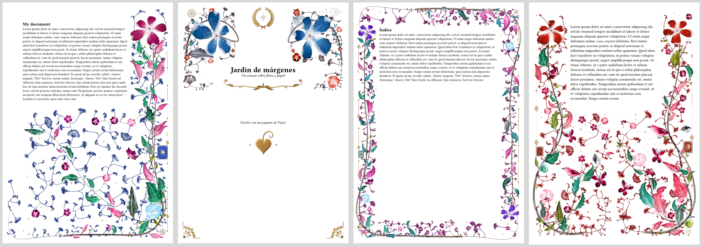
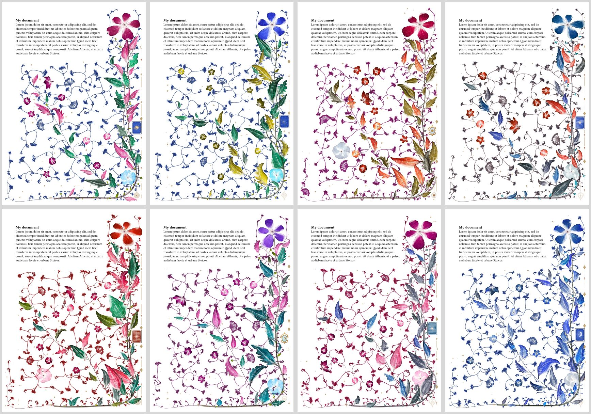
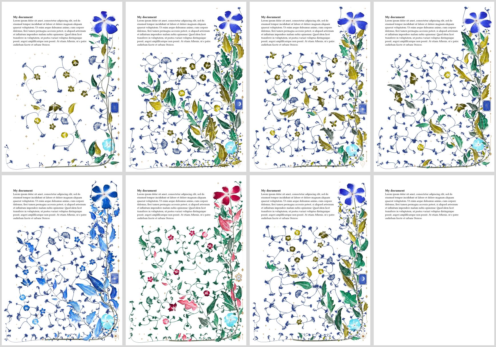
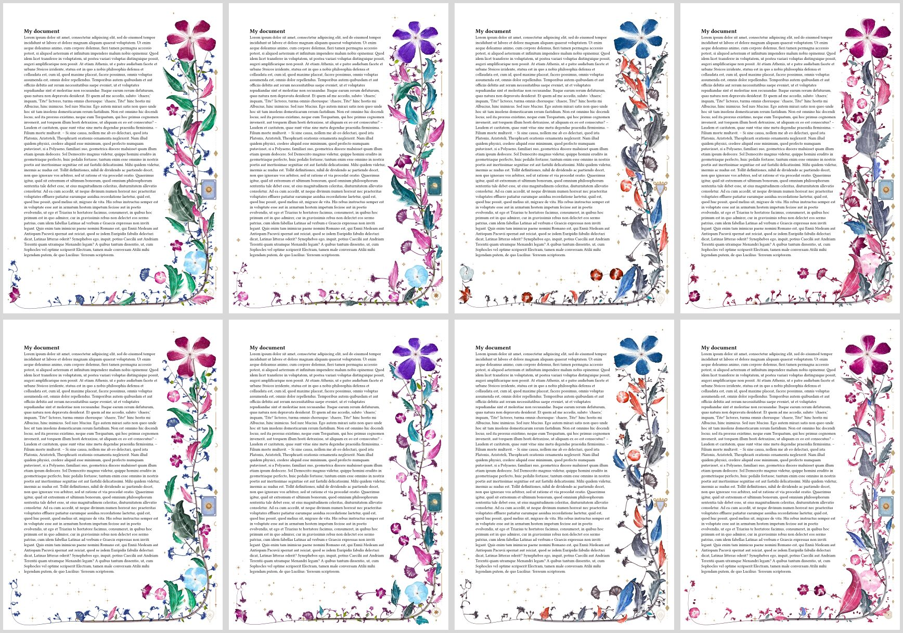
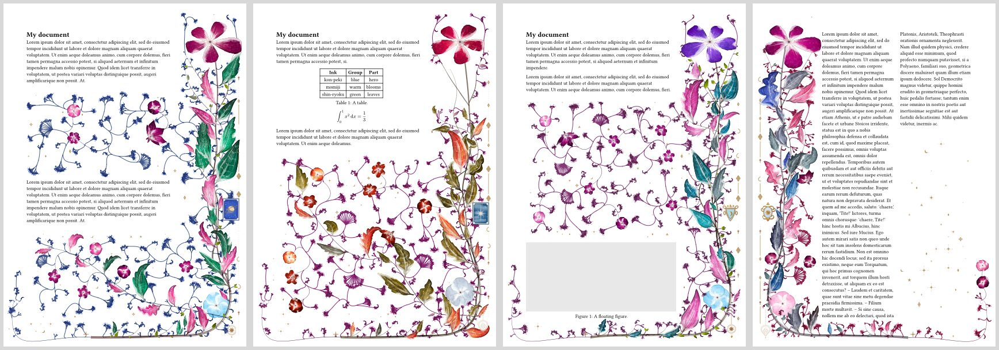

# Hortulus

[](https://typst.app/universe/package/hortulus)
[](package/typst.toml)
[](https://github.com/typst/typst/releases)
[](https://github.com/Richard7987/hortulus/releases/latest)
[](LICENSE)
[](plugin/)

Watercolour flora and gilt ornaments grown in the margins of Typst documents. Every page
grows its own plant around the text it holds, computed when the document compiles and
painted as vector paths. No tool is needed beyond Typst.

[Full documentation](package/README.md) ·
[Typst Universe](https://typst.app/universe/package/hortulus) ·
[Releases](https://github.com/Richard7987/hortulus/releases)



## Quick start

```typ
#import "@preview/hortulus:0.1.2": flora

#set page(margin: (left: 2.5cm, right: 5.5cm, y: 2.5cm))
#show: flora.with(layout: "right", colourway: "spring", seed: 7)

= My document
#lorem(200)
```

Give the flora room: about 5 cm for a side margin, or 3 cm all round for `surround`.
Every option is described in the [documentation](package/README.md#options). Pass
`draft: true` to leave the flora out while you write.

## Changes

**0.1.2** (in this repository, not yet on Typst Universe)

- `growth: "natural"`: side branches leave the main stem at a steady angle, bend back
  towards the light and branch again; most end in a bloom, and leaves shrink towards each
  tip. The default, `"classic"`, draws exactly as before.
- The development checks need only Rust: `tools/run_matrix.sh` compares the native output
  with stored checksums instead of running the Lua generator.

**0.1.1**

- PDFs about 45% smaller, and each page embeds faster: coordinates are written to a
  tenth of a point, and the smallest dots as squares or octagons of the same area, all
  within 0.03 mm of the previous drawing.
- A page whose spec has not changed is no longer grown again after an edit elsewhere in
  the document.

**0.1.0**: first release.

## Gallery

Up close: the blooms are vector paths painted like watercolour, and the gold is computed per pixel.


The eight colourways: `spring`, `summer`, `autumn` and `winter` above; `ember`, `plum`, `rose` and `original` below.



The same page with other options. Above: `density: 0.4`, `density: 2`, `visitors: 4` and `mix: (lily: 3, bloom: 0, umbel: 0)`. Below: `palette` with one ink, `palette` with two inks, `ornaments: (moon: 5, night: 0, sun: 0, planet: 0)` and `draft: true`.



The same four pages with `growth: "classic"` above and `growth: "natural"` below, in `spring`, `plum`, `winter` and `rose`: natural side branches leave the main stem, branch again and end in blooms.



The plant grows around what the page holds: a gap in the text, a table and an equation, a floating figure, and two columns with `layout: "split"`.



## Repository

- `package/`: the Typst package, as published.
- `plugin/`: the Rust source of the package's WebAssembly plugin.
- `tools/`: the build scripts and the tests.

## Building the plugin

You need a Rust toolchain with the `wasm32-unknown-unknown` target, and `wasm-opt` from Binaryen.

```sh
RUSTUP_HOME=... CARGO_HOME=... tools/build_wasm.sh   # see the script for the paths it sets
cp build/hortulus.wasm package/hortulus.wasm
```

## Rebuilding the images

With `typst` and ImageMagick on your path, `tools/build_gallery.sh` paints the gallery from
`tools/gallery/` into `package/images/`.

## Checking for changes

`tools/run_matrix.sh` builds the native binary, paints each case and compares a checksum of
the output with `tools/cases/expected.txt`. The classic cases were checked byte for byte
against the Lua generator before it left the toolchain. After an intended change in the
drawing, `UPDATE=1 tools/run_matrix.sh` writes the new sums. The package itself writes a more
compact encoding of the same drawing; pass `compact` as a fourth argument to `native` to get it.

## License

MIT. See `LICENSE`. The plugin ports [tikz-flora](https://github.com/wn-mitch/tikz-flora) (MIT).
